# SchoolMoney, opis funkcjonalności aplikacji

## Spis treści

1. [Role użytkowników](#1-role-użytkowników)
2. [Strona główna, rejestracja i logowanie](#2-strona-główna-rejestracja-i-logowanie)
3. [Pulpit](#3-pulpit)
4. [Moje dzieci](#4-moje-dzieci)
5. [Klasy](#5-klasy)
6. [Zbiórki](#6-zbiórki)
7. [Rachunek i płatności](#7-rachunek-i-płatności)
8. [Raporty](#8-raporty)
9. [Czat](#9-czat)
10. [Ustawienia konta](#10-ustawienia-konta)
11. [Panel administratora](#11-panel-administratora)
12. [Wersja mobilna](#12-wersja-mobilna)
13. [Bezpieczeństwo i poprawność danych](#13-bezpieczeństwo-i-poprawność-danych)

## 1. Role użytkowników

| Rola | Kto to jest | Co może |
|---|---|---|
| Gość | Osoba niezalogowana | Ogląda stronę główną, zakłada konto, loguje się. |
| Rodzic | Każdy zalogowany użytkownik | Dodaje dzieci, zapisuje je do klas kodem, wpłaca na zbiórki, korzysta z rachunku i czatu. |
| Skarbnik | Rodzic, który założył klasę | Dodatkowo zarządza klasą, przyjmuje dzieci, tworzy zbiórki, wypłaca środki i dodaje faktury. |
| Administrator | Konto systemowe tworzone przy starcie aplikacji | Korzysta z panelu administratora: przegląda statystyki i raporty całej platformy, blokuje i odblokowuje konta, klasy i zbiórki, przy blokadzie zbiórki zwraca wpłaty rodzicom. Prowadzi rozmowy na czacie z każdym użytkownikiem. |

## 2. Strona główna, rejestracja i logowanie

### 2.1. Strona główna

Strona dla niezalogowanych użytkowników. Przedstawia aplikację, sposób działania („Jak to działa”), funkcje i najczęstsze pytania (FAQ) oraz prowadzi do rejestracji i logowania. Zalogowany użytkownik, który wejdzie na stronę główną, jest od razu przekierowywany na pulpit.

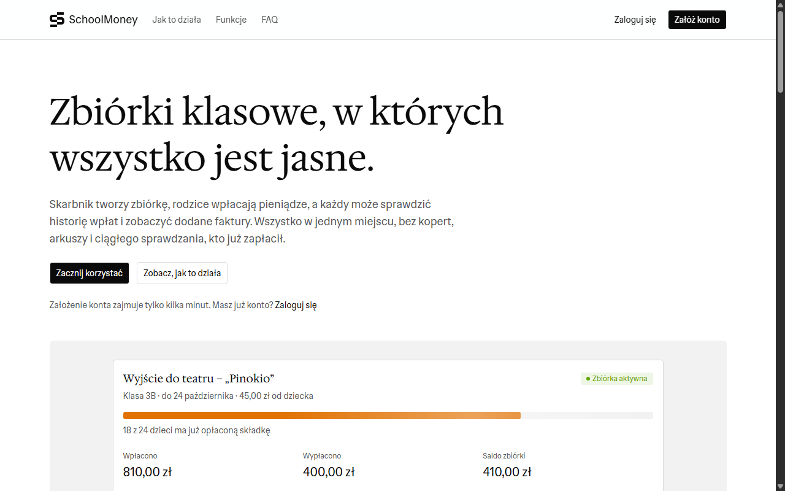

### 2.2. Rejestracja

Formularz zakładania konta z wyborem typu konta: **Rodzic** albo **Skarbnik klasy**. Wybór wpływa tylko na podpowiedzi po rejestracji, skarbnik zobaczy na pulpicie przewodnik zakładania klasy.

- Imię i nazwisko wpisuje się w jednym polu, oddzielone spacją.
- Adres e-mail musi być poprawny i niezajęty.
- Hasło ma od 8 do 72 znaków i może zawierać tylko litery a–z i A–Z, cyfry, spację i symbole. Pole nie przyjmuje innych znaków, np. polskich liter.
- Hasło trzeba powtórzyć; niezgodność jest pokazywana od razu pod polem.
- Po rejestracji użytkownik jest od razu zalogowany.

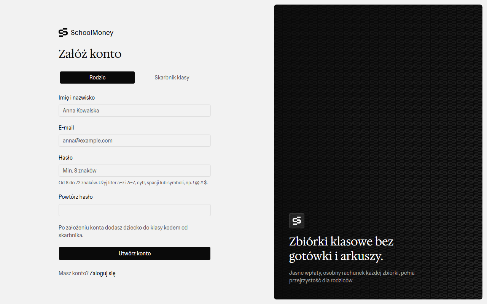

### 2.3. Logowanie i wylogowanie

Logowanie adresem e-mail i hasłem. Sesja jest przechowywana w przeglądarce jako token JWT. Wylogowanie jest dostępne w menu użytkownika (ikona z inicjałami w prawym górnym rogu). Niezalogowany użytkownik, który próbuje otworzyć stronę aplikacji, trafia na ekran logowania.

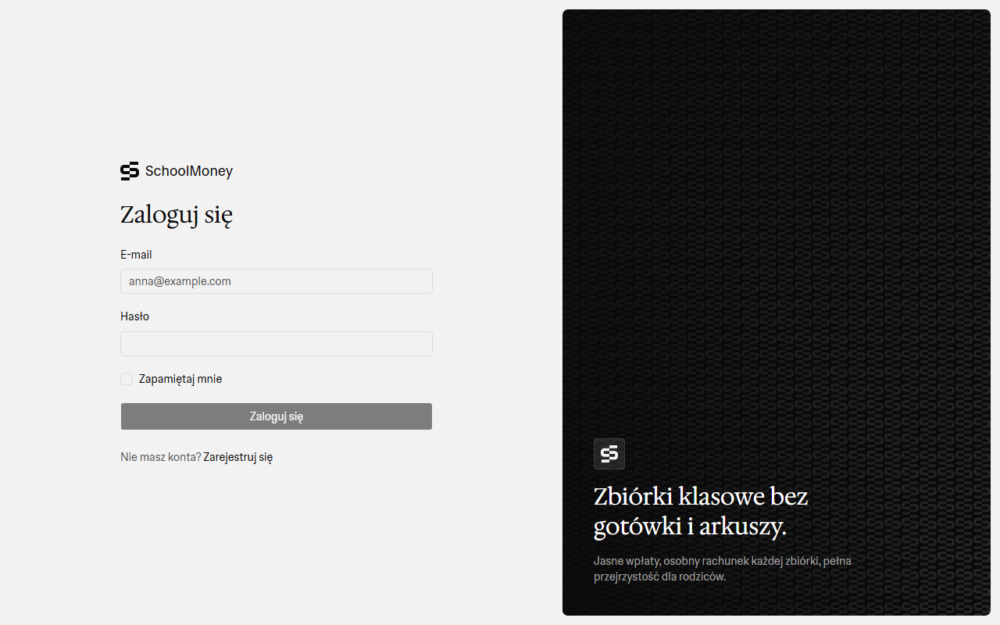

## 3. Pulpit

Pierwszy ekran po zalogowaniu. Jego zawartość zależy od tego, czy użytkownik prowadzi klasę.

### 3.1. Przewodnik dla nowego skarbnika

Nowy skarbnik widzi listę czterech kroków konfiguracji klasy z paskiem postępu:

1. Załóż klasę.
2. Przekaż kod rodzicom (z przyciskiem kopiowania kodu).
3. Zatwierdź zgłoszenia.
4. Utwórz pierwszą zbiórkę.

Każdy krok ma przycisk prowadzący do odpowiedniej akcji. Gdy wszystkie kroki są zrobione, przewodnik znika.

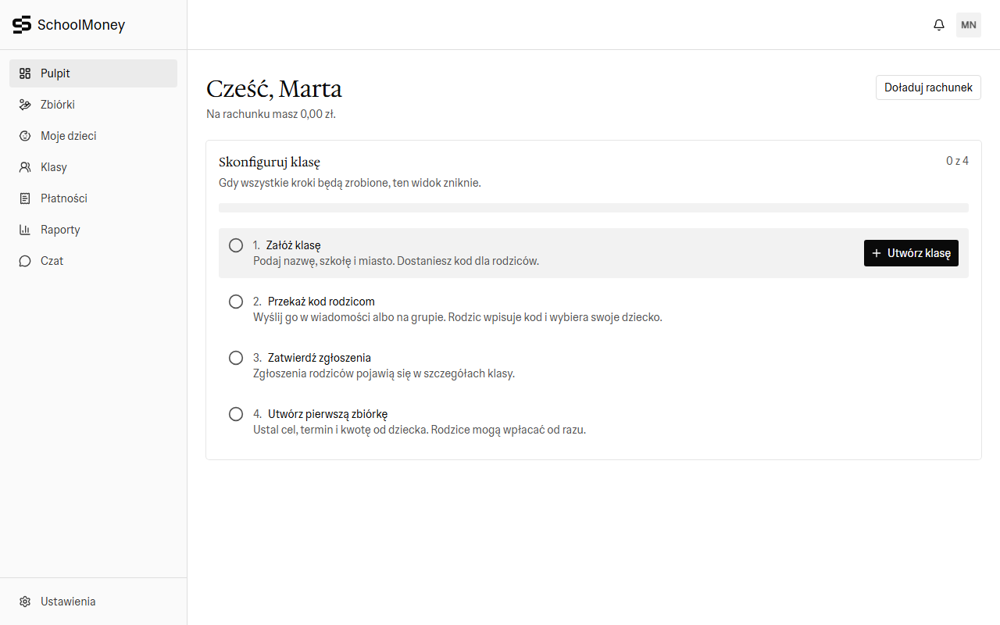

### 3.2. Pulpit skarbnika

- **Wskaźniki:** dostępne środki, kwota jeszcze niezapłacona przez rodziców, wpływy, wydatki i bilans z ostatnich 30 dni.
- **Do zapłaty:** opłaty za własne dzieci skarbnika z przyciskiem „Zapłać”.
- **Wpływy i wydatki:** wykres ruchu na rachunku z ostatnich 30 dni.
- **Ostatnie transakcje:** z podziałem na wszystkie, wpływy, wydatki i zwroty.
- **Rachunki:** rachunek osobisty i rachunki wszystkich zbiórek z saldami.
- **Terminy:** trwające zbiórki z liczbą dni do końca i postępem wpłat.

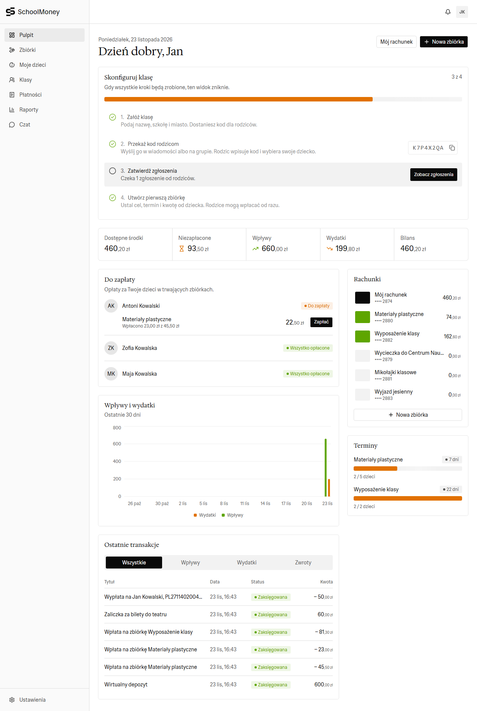

### 3.3. Pulpit rodzica

Rodzic widzi saldo rachunku, przycisk doładowania, listę opłat do zrobienia za swoje dzieci (z kwotą pozostałą do zapłaty) oraz historię swoich wpłat. Jeśli dziecko czeka na przyjęcie do klasy, pulpit o tym informuje.

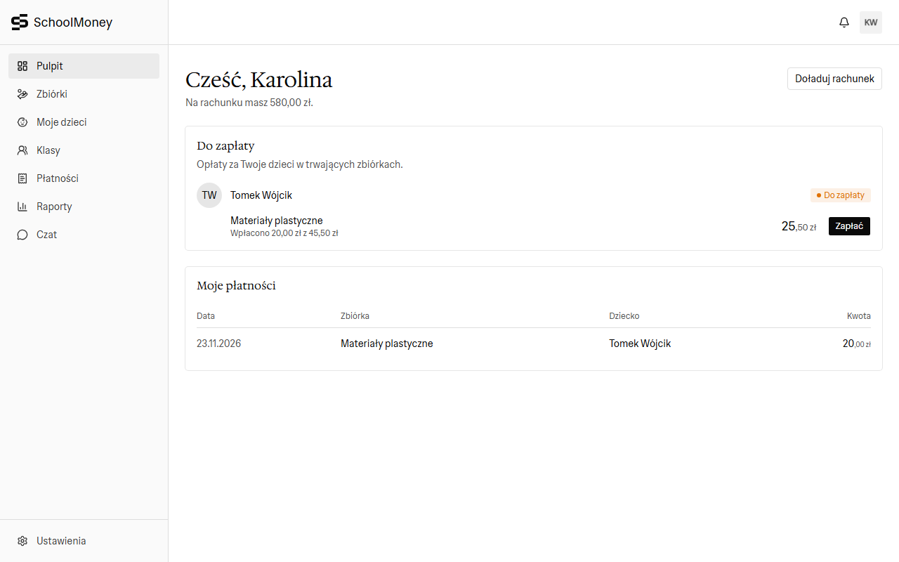

### 3.4. Powiadomienia skarbnika

Skarbnik ma w górnym pasku ikonę dzwonka z licznikiem nowych powiadomień od ostatniego otwarcia listy. Powiadomienia odświeżają się automatycznie co kilka sekund i obejmują:

- **Zgłoszenia do zatwierdzenia:** liczbę dzieci czekających na przyjęcie w każdej klasie.
- **Nowe wpłaty na zbiórki:** kto, za jaką zbiórkę i ile wpłacił.

Przycisk „Otwórz” przy powiadomieniu prowadzi do odpowiedniej klasy albo zbiórki. Rodzic, który nie prowadzi klasy, nie widzi dzwonka.

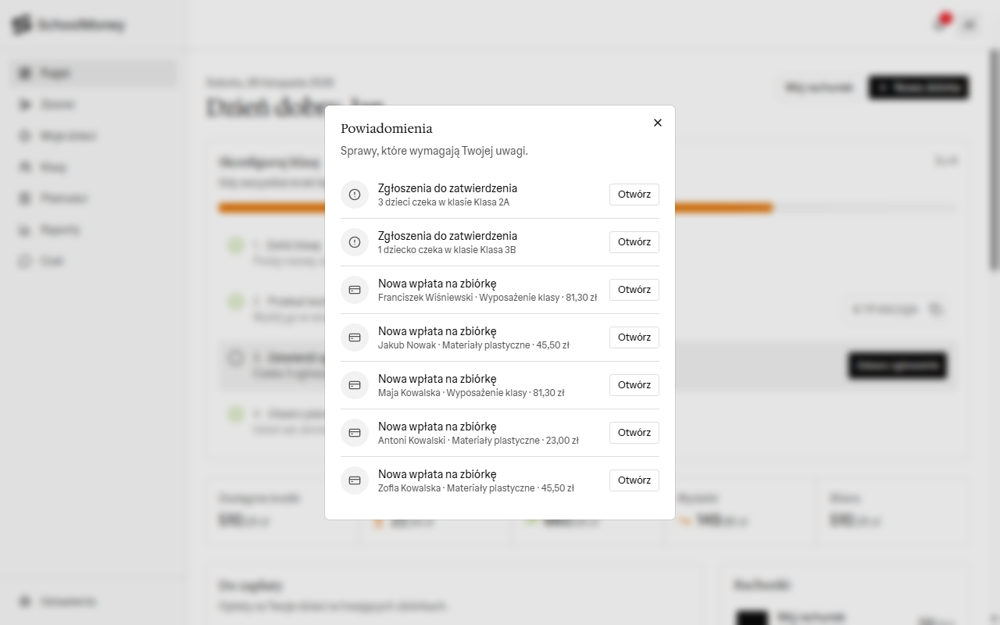

## 4. Moje dzieci

Lista dzieci użytkownika. Rodzic może mieć dowolną liczbę dzieci, także w różnych klasach.

- **Dodanie dziecka:** imię, nazwisko i data urodzenia.
- **Edycja danych** i **usunięcie dziecka**.
- **Zdjęcie dziecka:** wgranie zdjęcia (PNG lub JPG, maks. 5 MB); zdjęcie można zmienić lub usunąć. Bez zdjęcia wyświetlane są inicjały dziecka.
- **Dołączenie do klasy:** rodzic wpisuje kod klasy otrzymany od skarbnika, widzi nazwę klasy i szkoły, a następnie wysyła zgłoszenie. Dziecko trafia do klasy po zatwierdzeniu przez skarbnika.
- **Wypisanie z klasy:** rodzic może wypisać dziecko z klasy.

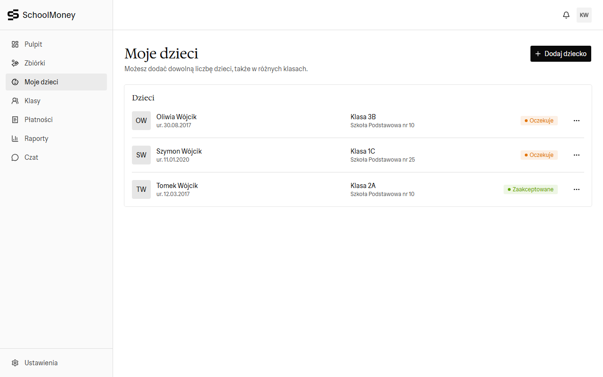

## 5. Klasy

### 5.1. Lista klas

Klasy prowadzone przez użytkownika oraz klasy, do których należą jego dzieci, z filtrem. Z tego miejsca skarbnik zakłada nową klasę (nazwa, szkoła, miasto).

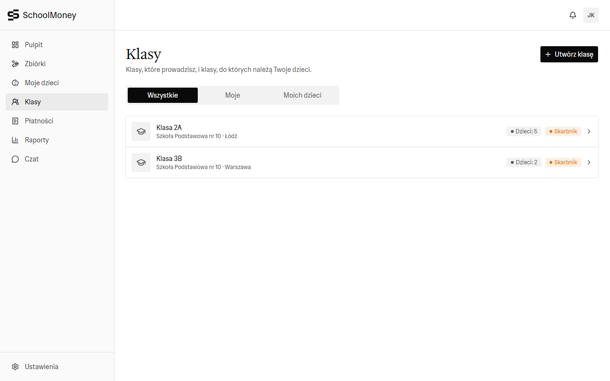

### 5.2. Szczegóły klasy

- **Zbiórki klasy** z ich statusami i przyciskiem tworzenia nowej zbiórki.
- **Dzieci w klasie** wraz z rodzicami; skarbnik może usunąć dziecko z klasy.
- **Prośby o dołączenie:** skarbnik przyjmuje albo odrzuca zgłoszenia rodziców. Rodzic widzi przy dziecku status zgłoszenia (oczekuje, przyjęte, odrzucone).
- **Kod zaproszenia:** domyślnie ukryty; można go pokazać, skopiować albo wygenerować nowy (stary przestaje wtedy działać).
- **Czat klasy:** przycisk otwiera rozmowę klasową.
- **Edycja i usunięcie klasy:** usunąć można tylko klasę bez zbiórek.

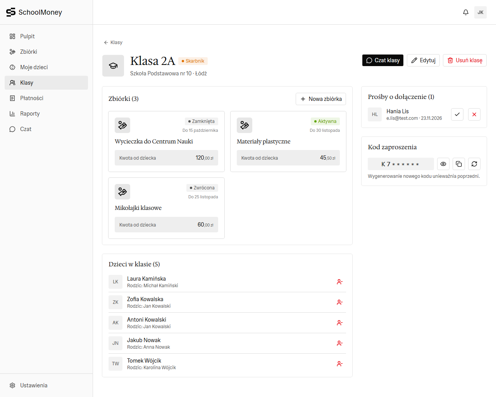

## 6. Zbiórki

### 6.1. Lista zbiórek

Zbiórki z klas prowadzonych przez użytkownika i z klas jego dzieci, z filtrem. Każda zbiórka ma status:

| Status | Znaczenie |
|---|---|
| Trwa | Zbiórka przyjmuje wpłaty. |
| Zamknięta | Zbiórka zakończona przez skarbnika. |
| Zamknięta ze zwrotem | Zbiórka anulowana, wpłaty zwrócono rodzicom. |
| Zablokowana | Zbiórka zablokowana przez administratora (bezpośrednio albo przez zablokowanie klasy), nie przyjmuje wpłat ani wypłat. |

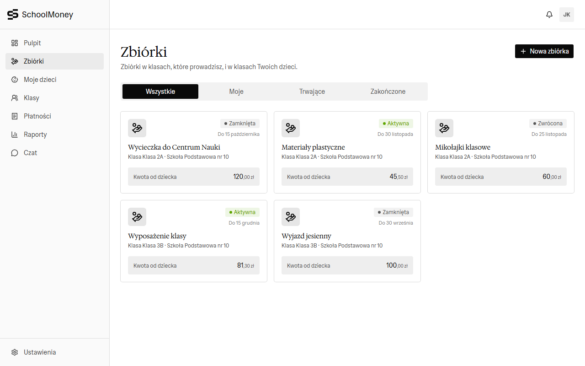

### 6.2. Tworzenie i edycja zbiórki

Skarbnik wybiera klasę, wpisuje cel zbiórki, opis, termin wpłat i kwotę od dziecka oraz opcjonalnie dodaje logo (PNG lub JPEG). Rodzice widzą zbiórkę od razu po utworzeniu. Zbiórkę można edytować, dopóki trwa.

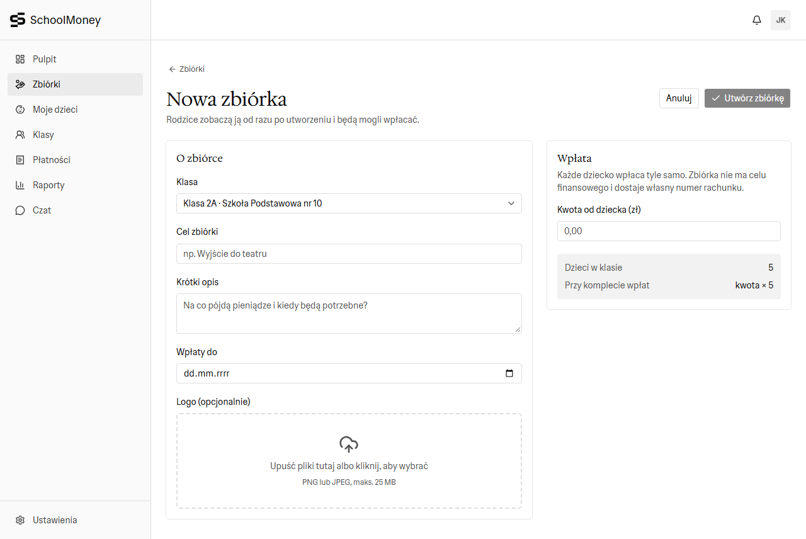

### 6.3. Szczegóły zbiórki

- **Podsumowanie:** liczba dzieci, które opłaciły składkę, suma wpłat, wypłat i saldo zbiórki.
- **Moje dzieci:** stan opłaty za każde dziecko użytkownika.
- **Postęp klasy:** ile dzieci już opłaciło składkę.
- **Rachunek zbiórki:** indywidualny numer IBAN zbiórki.
- **Historia zbiórki** w trzech zakładkach:
  - **Wpłaty:** kto, za kogo, kiedy i ile wpłacił;
  - **Wypłaty i zwroty:** wypłaty skarbnika, zwroty wypłaconych środków i zwroty wpłat rodzicom;
  - **Faktury:** dokumenty zakupów do podglądu i pobrania.

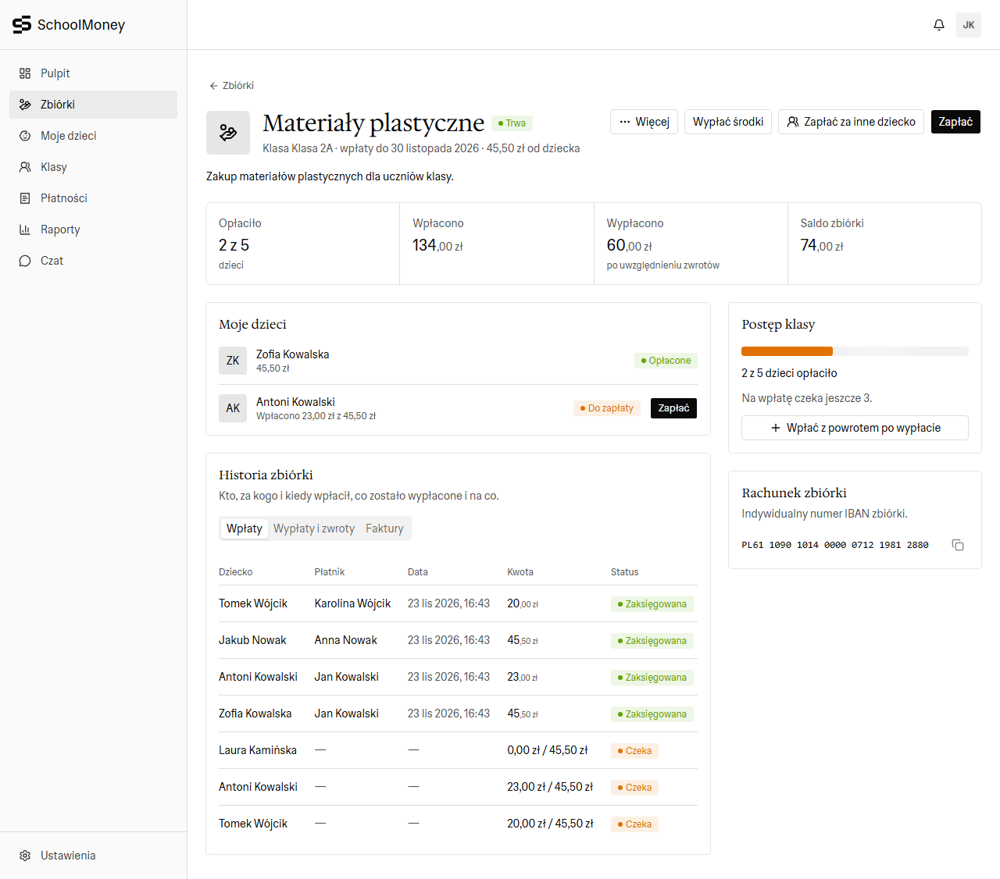

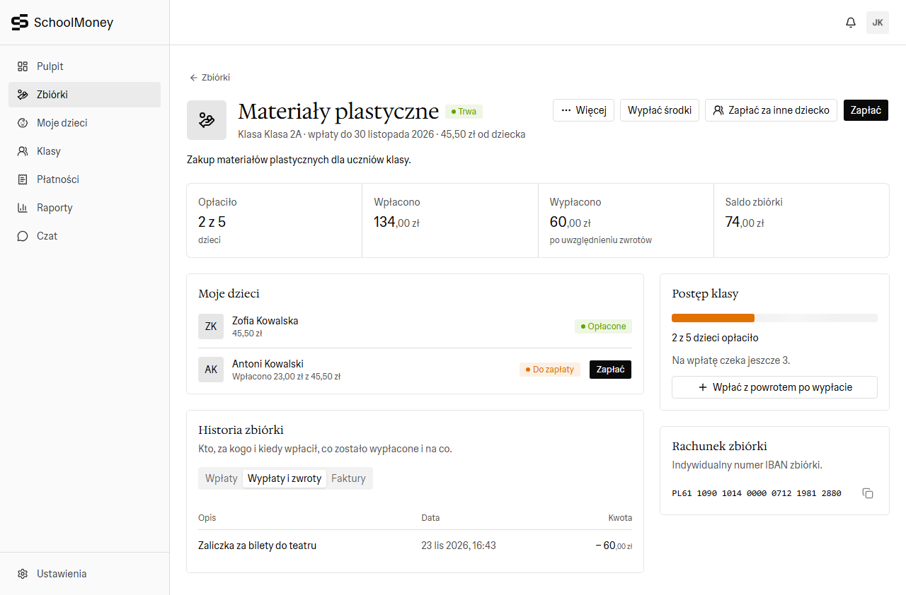

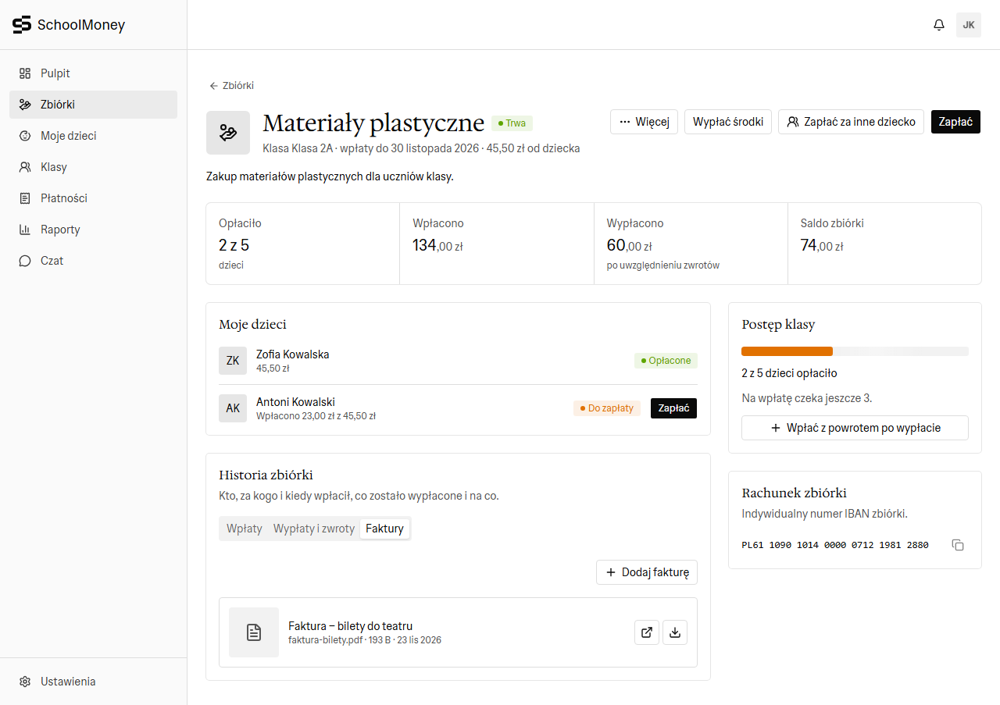

### 6.4. Wpłata na zbiórkę

Wpłata jest pobierana z rachunku osobistego użytkownika.

- Można zapłacić za własne dziecko albo – przyciskiem „Zapłać za inne dziecko” – za dowolne dziecko z klasy.
- Można wpłacić całą brakującą kwotę albo **zapłacić w częściach**; okno pokazuje dotychczasowe wpłaty, kwotę pozostałą do zapłaty i saldo po wpłacie.
- Suma wpłat za dziecko nie może przekroczyć kwoty na dziecko, a wpłata nie może przekroczyć salda rachunku.

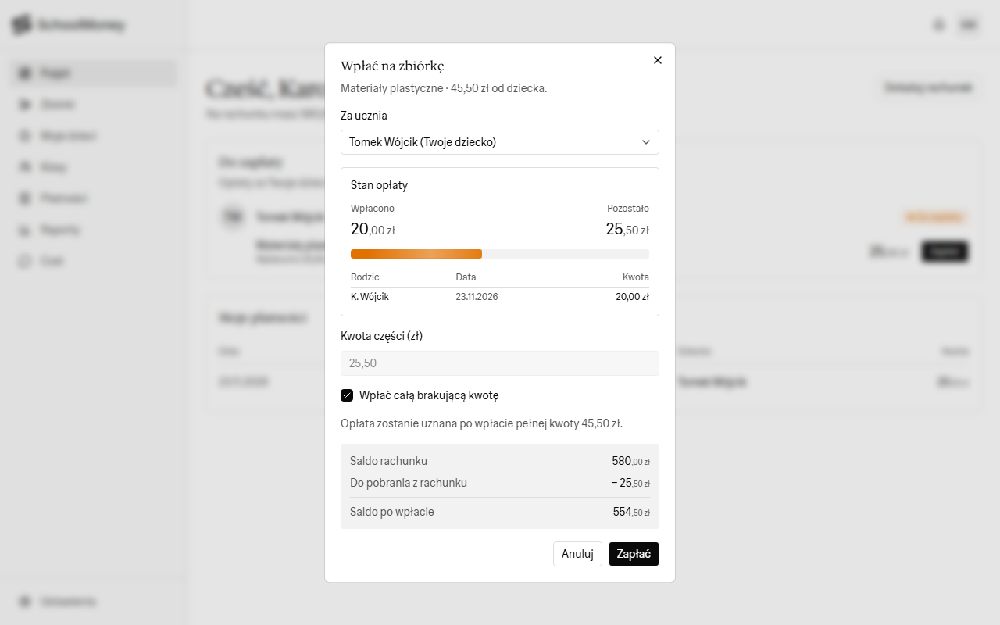

### 6.5. Zarządzanie pieniędzmi zbiórki (skarbnik)

- **Wypłata środków** z rachunku zbiórki na rachunek osobisty skarbnika, z opisem wydatku i opcjonalną fakturą.
- **Zwrot wypłaconych środków** z powrotem na rachunek zbiórki („Wpłać z powrotem po wypłacie”).
- **Dodanie faktury** (PNG, JPEG lub PDF) z opcjonalnym tytułem.
- **Zamknięcie zbiórki:**
  - jeśli rachunek zbiórki zawiera wszystkie wpłaty, skarbnik może zamknąć zbiórkę ze zwrotem i pieniądze automatycznie wracają do rodziców (okno pokazuje, ile dostanie każdy z nich);
  - jeśli część pieniędzy wypłacono, trzeba je najpierw zwrócić na rachunek zbiórki;
  - zbiórkę z pustym rachunkiem można zamknąć bez zwrotu.

## 7. Rachunek i płatności

Każdy użytkownik ma wirtualny rachunek osobisty z numerem IBAN.

- **Saldo** i numer rachunku z przyciskiem kopiowania.
- **Doładowanie:** symulacja przelewu przychodzącego na rachunek.
- **Wypłata:** symulacja przelewu na rachunek zewnętrzny (nazwa odbiorcy i IBAN). Nie można wypłacić na rachunek należący do systemu ani więcej, niż jest na rachunku.
- **Zapisani odbiorcy:** przy wypłacie można zaznaczyć „Zapamiętaj ten rachunek”. Przy kolejnej wypłacie odbiorcę wybiera się z listy, bez ponownego wpisywania nazwy i numeru IBAN.
- **Historia transakcji:** doładowania, wypłaty, wpłaty na zbiórki i zwroty, ze stronicowaniem.
- **Historia wpłat na zbiórki**, także tych za cudze dzieci.
- **Zaawansowane filtrowanie** historii: rodzaj operacji, przedział dat, przedział kwot i wyszukiwanie po tytule, nazwie zbiórki lub imieniu dziecka. Aktywne filtry są widoczne jako etykiety, które można usuwać pojedynczo.

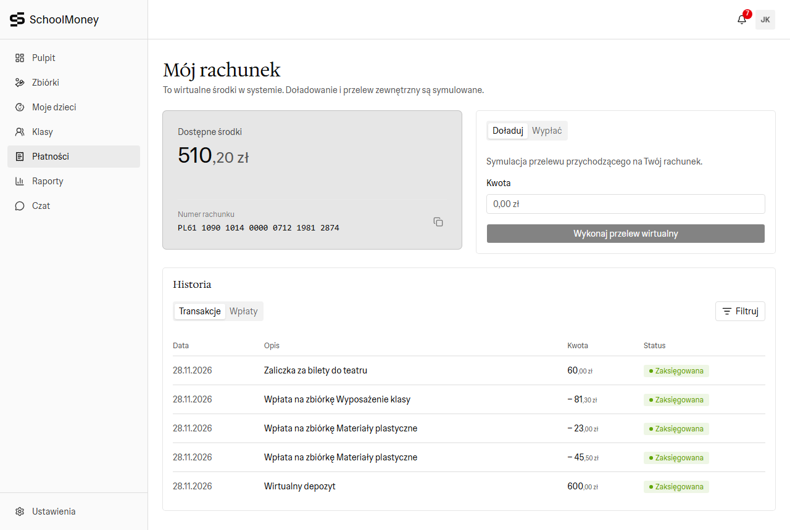

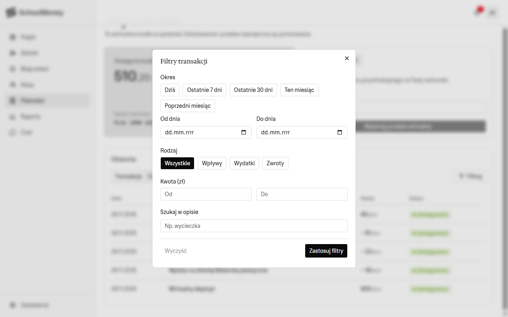

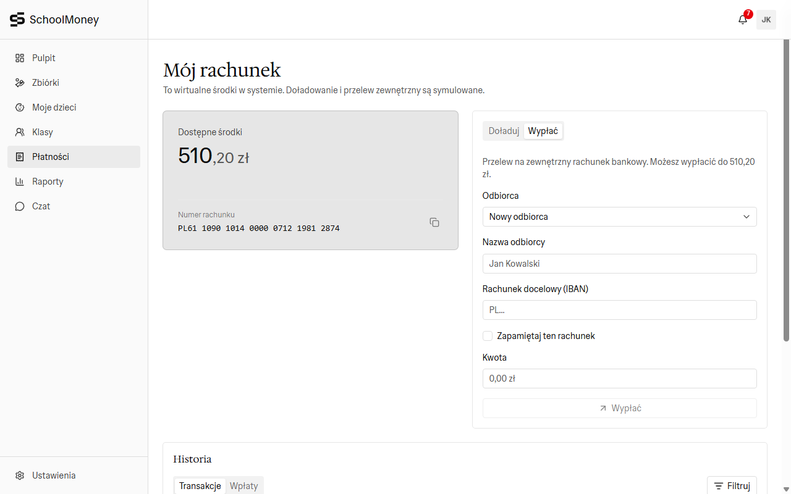

## 8. Raporty

Strona „Raporty” w menu bocznym pozwala pobrać zestawienie finansowe: wpłaty z płatnikiem i dzieckiem, zwroty, wypłaty i uzupełnienia.

- **Zakres raportu:**
  - **zbiórka:** dla skarbnika klasy i rodziców przyjętych dzieci;
  - **dziecko:** dla rodzica dziecka;
  - **klasa:** dla skarbnika klasy.
- **Okres:** opcjonalne daty od–do. Puste pola oznaczają cały okres trwania zbiórki, a daty obejmują dzień początkowy i końcowy.
- **Format:** PDF albo CSV do otwarcia w Excelu.

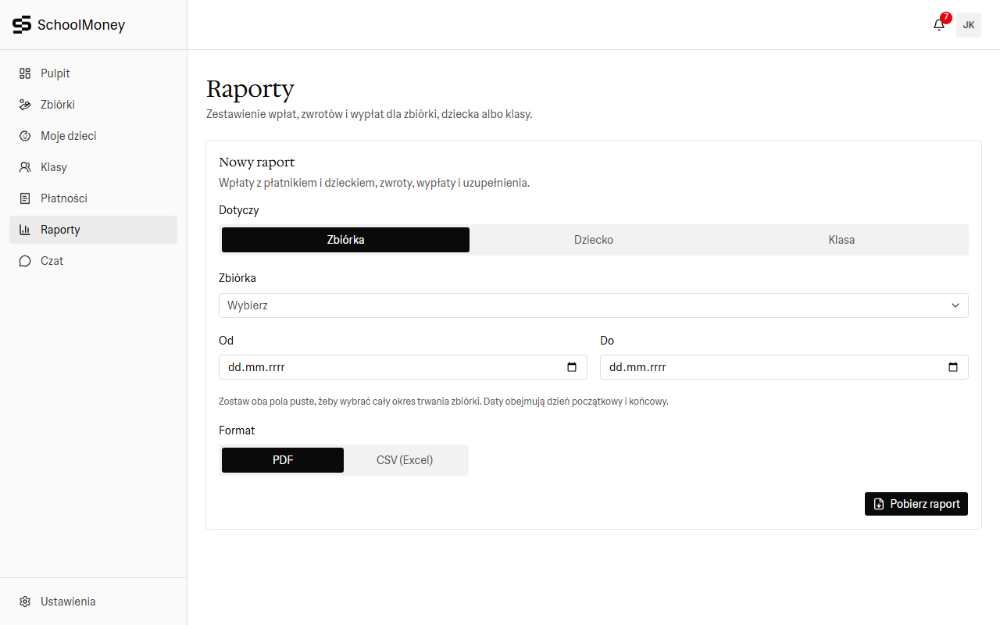

## 9. Czat

Rozmowy tekstowe między użytkownikami.

- **Czat klasy:** wspólna rozmowa skarbnika i rodziców przyjętych dzieci; tworzony automatycznie dla każdej klasy.
- **Rozmowy prywatne:** z osobami ze wspólnych klas oraz z administratorem. Przycisk „Nowa rozmowa” pokazuje tylko osoby, do których wolno pisać.
- **Bezpieczeństwo:** gdy użytkownicy przestają mieć wspólną klasę, nie mogą już do siebie pisać; historia rozmowy zostaje widoczna. Serwer sprawdza to przy każdej wiadomości.
- **Usunięte i zablokowane konto:** rozmowa z osobą, która usunęła konto albo została zablokowana przez administratora, zostaje widoczna, ale nie da się już w niej pisać. Usunięte konto jest pokazywane jako „Usunięte konto”.
- **Nieprzeczytane wiadomości:** licznik przy każdej rozmowie; wiadomości są oznaczane jako przeczytane po otwarciu rozmowy.
- **Ukrywanie rozmów:** rozmowę można ukryć z listy; wraca, gdy przyjdzie nowa wiadomość. Pusta prywatna rozmowa znika z listy po przejściu do innej.
- **Odświeżanie:** nowe wiadomości pojawiają się automatycznie (co 3 sekundy w otwartej rozmowie, lista rozmów co 10 sekund).
- **Wyszukiwanie** rozmów na liście oraz wczytywanie starszych wiadomości.

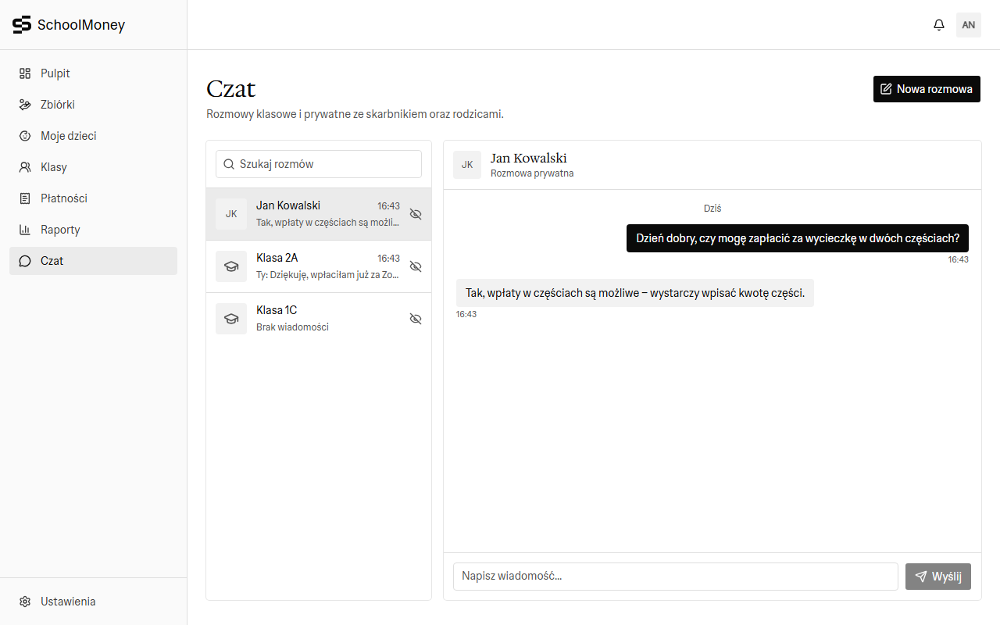

## 10. Ustawienia konta

Dostępne z menu bocznego („Ustawienia”).

- **Dane osobowe:** zmiana imienia i nazwiska.
- **Adres e-mail:** zmiana adresu po podaniu obecnego hasła; zajęty adres jest odrzucany.
- **Hasło:** zmiana po podaniu obecnego hasła; nowe hasło spełnia te same zasady co przy rejestracji.
- **Usunięcie konta:** po potwierdzeniu hasłem. Dane osobowe są anonimizowane, a konto blokowane; historia wpłat zostaje w zbiórkach jako „Usunięte konto”. Usunięcie nie jest możliwe, dopóki użytkownik prowadzi klasę albo ma pieniądze na rachunku – aplikacja pokazuje wtedy, co trzeba zrobić najpierw.

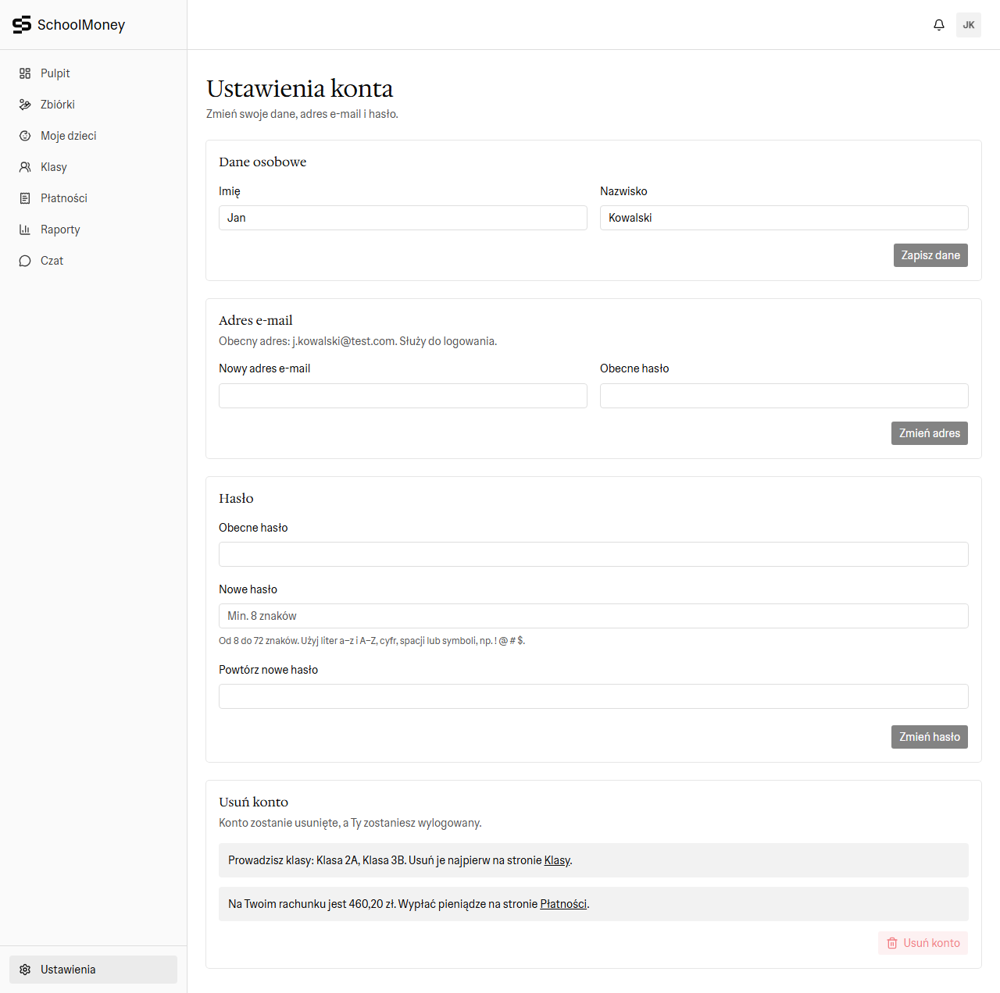

## 11. Panel administratora

Po zalogowaniu administrator trafia do panelu administratora. Poza panelem ma dostęp tylko do czatu; próba otwarcia innej strony aplikacji przenosi go z powrotem do panelu. Panel ma zakładki: Przegląd, Użytkownicy, Skarbnicy, Klasy, Zbiórki i Raporty.

### 11.1. Przegląd

- **Statystyki platformy:** liczba użytkowników, skarbników, klas i aktywnych zbiórek (z liczbą zakończonych).
- **Podsumowanie finansowe:** suma zebrana we wszystkich zbiórkach, obrót (wpłaty i doładowania) oraz nowi użytkownicy z ostatnich 6 miesięcy, a także liczba zablokowanych kont, klas i zbiórek.
- **Obrót w ostatnich miesiącach:** tabela z obrotem, nowymi użytkownikami i zbiórkami w każdym miesiącu, z odnośnikiem do pełnego raportu.
- **Ostatnia aktywność:** najnowsze rejestracje, nowe klasy i nowe zbiórki.
- **Skarbnicy i zbiórki:** ostatnio zarejestrowani skarbnicy i najnowsze zbiórki, z odnośnikami do pełnych list.
- **Szybkie przejścia** do raportów i zarządzania użytkownikami.

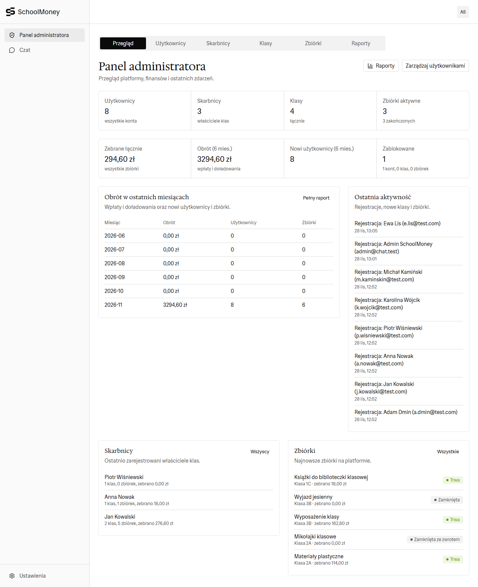

### 11.2. Zarządzanie użytkownikami, skarbnikami, klasami i zbiórkami

Każda zakładka zawiera tabelę z wyszukiwarką i sortowaniem po kolumnach.

- **Użytkownicy:** wszystkie konta z rolą, liczbą klas, datą dołączenia i statusem. Zablokowany użytkownik nie może się zalogować. Konta administratora nie da się zablokować.
- **Skarbnicy:** właściciele klas z liczbą klas, zbiórek i łącznie zebraną kwotą. Skarbnika można zablokować tak samo jak każde konto.
- **Klasy:** wszystkie klasy ze szkołą, skarbnikiem, liczbą dzieci i zbiórek. Do zablokowanej klasy nie można dołączyć ani jej zmieniać, a jej zbiórki wstrzymują wpłaty.
- **Zbiórki:** wszystkie zbiórki z klasą, zebraną kwotą, statusem i datą utworzenia. Zablokowana zbiórka nie przyjmuje wpłat ani wypłat.

Blokowanie i odblokowanie wymaga potwierdzenia w oknie dialogowym, a blokadę można w każdej chwili cofnąć. Przy blokowaniu trwającej zbiórki administrator może od razu zwrócić wszystkie wpłaty płatnikom („Zablokuj i zwróć środki”).

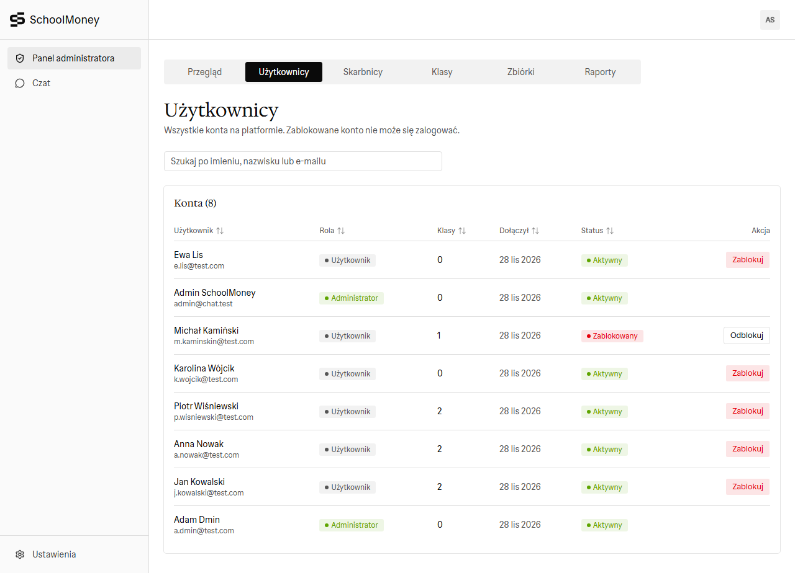

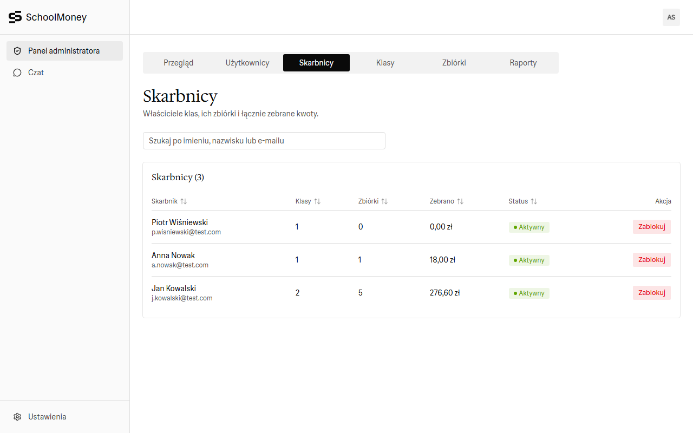

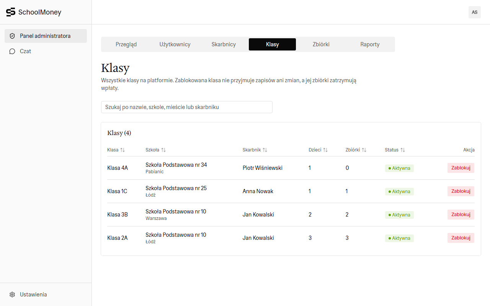

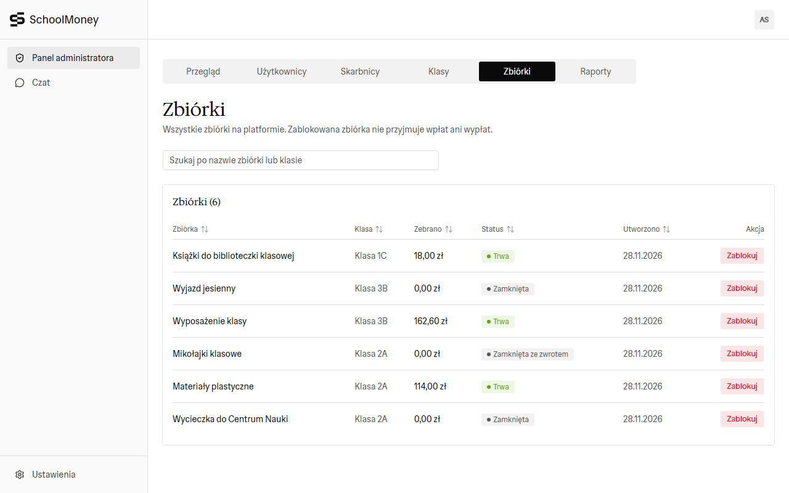

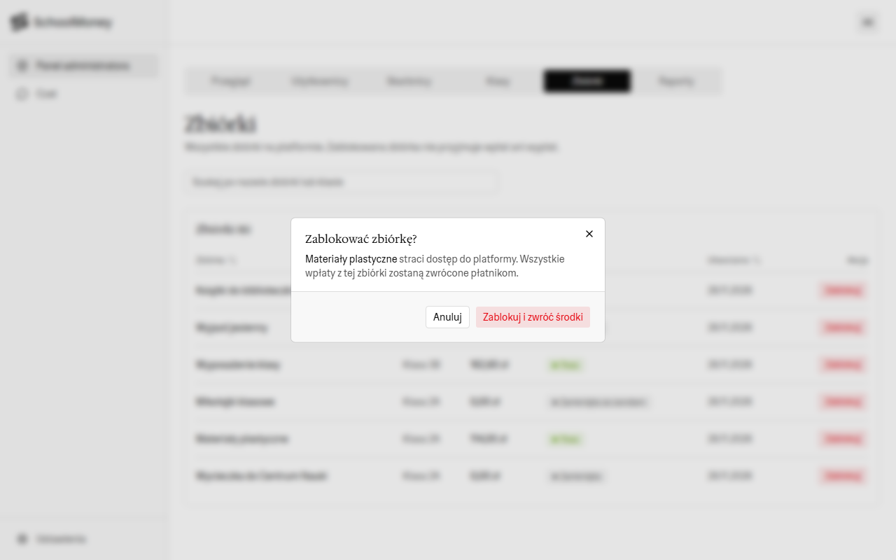

### 11.3. Raporty finansowe

Zestawienie całej platformy w podziale na miesiące: obrót (wpłaty i doładowania), nowi użytkownicy i nowe zbiórki, z wyborem okresu od–do (do 24 miesięcy) i sortowaniem kolumn. Wybór okresu jest dostępny, gdy na platformie są dane z co najmniej dwóch miesięcy.

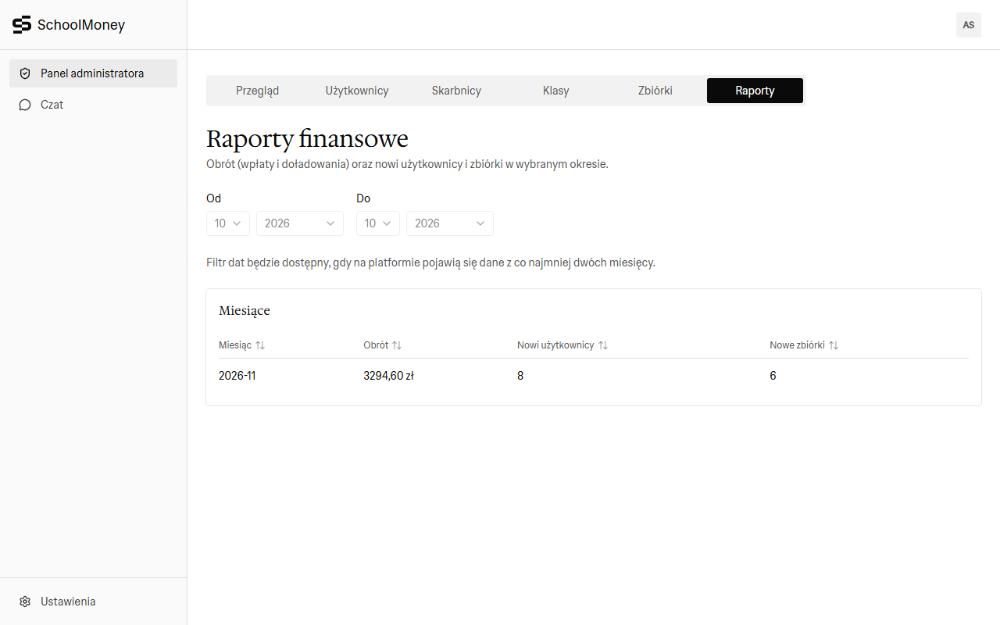

### 11.4. Kontakt ze skarbnikami

Administrator korzysta z czatu: może rozpocząć prywatną rozmowę z każdym skarbnikiem i rodzicem, a każdy użytkownik może napisać do administratora.

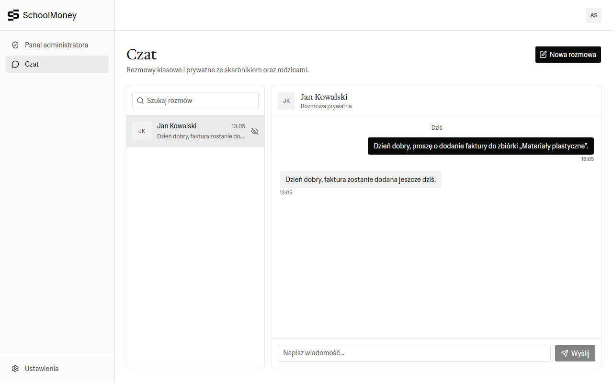

## 12. Wersja mobilna

Interfejs dostosowuje się do szerokości ekranu. Na telefonie menu boczne zastępuje dolny pasek nawigacji, a okna dialogowe otwierają się jako panele wysuwane od dołu ekranu.

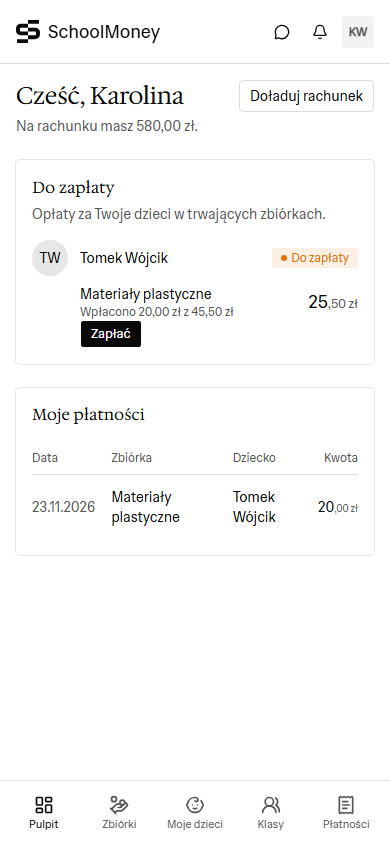

## 13. Bezpieczeństwo i poprawność danych

- **Uwierzytelnianie:** każde żądanie do API, poza rejestracją, logowaniem i sprawdzeniem kodu klasy, wymaga tokenu JWT. Konto zablokowane przez administratora albo usunięte traci dostęp od razu.
- **Uprawnienia:** serwer sprawdza przy każdej operacji, czy użytkownik ma dostęp do klasy, zbiórki, dziecka lub rozmowy. Operacje skarbnika są dostępne tylko dla właściciela klasy, a operacje panelu administratora – tylko dla administratora.
- **Hasła:** przechowywane wyłącznie jako skrót bcrypt.
- **Walidacja danych:** pola formularzy mają limity długości i formatu sprawdzane w przeglądarce (pola nie przyjmują niepoprawnych znaków) i ponownie na serwerze.
- **Pieniądze:** kwoty są liczone z dokładnością do grosza; nie da się wpłacić więcej, niż wynosi składka, ani wydać więcej, niż jest na rachunku.